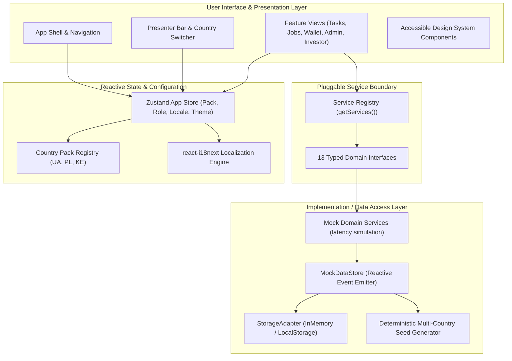

# System Architecture & Technical Design

This document details the software architecture, design patterns, and component boundaries of **WorkHub**.

---

## 1. Architectural Philosophy

WorkHub is architected around three foundational principles:
1. **Strict Jurisdiction Decoupling (Country Packs)**: No country-specific logic, regulatory rules, tax classifications, or currencies are hard-coded into UI components. The platform is parameterized through typed, schema-validated Country Packs.
2. **Pluggable Service Layer (Interface-First Boundary)**: The user interface communicates exclusively with domain service interfaces via a singleton registry. The current in-memory reactive mock layer can be swapped for a real REST/GraphQL client with zero UI changes.
3. **Zero-Retention Trust Infrastructure**: High-trust physical interactions require verification without surveillance. Identity documents are processed by accredited third-party identity partners; WorkHub stores only cryptographically signed verification tokens and level statuses (L0–L3).

---

## 2. High-Level Architecture Diagram



---

## 3. The Three Structural Layers

### Layer 1: Marketplace Engine
Responsible for demand aggregation, matching, and communications.
* **Smart Task Catalog**: Categorized templates with preset milestones, duration estimates, and indicative pricing ranges.
* **Smart Offers**: Bids require price, estimated lead time, and starting availability.
* **Masked Communication Channel**: Proprietary regex filtering masks telephone numbers, emails, URLs, and messaging handles (`t.me`, `wa.me`) prior to formal contract signing and escrow funding.
* **MapStub Visualizer**: Pure inline SVG projection of cities and job densities without leaking exact residential street addresses.

### Layer 2: Trust & Protected Payments Layer
Guarantees financial integrity and safety for both parties.
* **Licensed Escrow Rail (Segregated Funds)**: Funds are deposited with an accredited financial institution partner before work begins. WorkHub operates strictly as an orchestrator, never taking legal deposit custody.
* **Milestone Releases**: Jobs are divided into deliverable stages. Releasing one milestone allows work to continue with verified interim payouts.
* **Tiered Verification (L0 to L3)**:
  * **L0**: Phone / Email verified (Basic exploratory tier, low transaction cap).
  * **L1**: Government document + biometric selfie match.
  * **L2**: National digital identity authentication (e.g. Diia, mObywatel, National Digital ID).
  * **L3**: Regulated trade certification / background clearance (e.g., electrical license).
* **Algorithmic Trust Score (0–100)**:
  $$\text{Score} = \text{Verification Tier} (30\%) + \text{Completed Jobs} (30\%) + \text{Rating Criteria} (25\%) + \text{Dispute Record} (15\%)$$

### Layer 3: Compliance & Social Programs Layer
Provides legal certainty, tax reporting support, and social mobility.
* **Dynamic Contract Synthesis**: Bilateral contracts and completion acts are compiled automatically from jurisdictional templates using placeholder substitution (`{{customer_name}}`, `{{agreed_amount}}`, etc.).
* **B2B Procurement**: Companies manage internal members, dispatch crews, and generate corporate expense reports.
* **Priority Access Framework**: Accredited social groups (military veterans, workers aged 50+, refugees, youth) receive platform fee subsidies, algorithmic dispatch boosts, and partner impact tracking.

---

## 4. Service Registry Pattern

The UI interacts solely with service interfaces defined in `src/services/interfaces.ts`:

```typescript
// Example: src/services/registry.ts
export interface ServiceRegistry {
  users: UserService;
  tasks: TaskService;
  offers: OfferService;
  jobs: JobService;
  payments: PaymentService;
  identity: IdentityService;
  documents: DocumentService;
  disputes: DisputeService;
  reviews: ReviewService;
  wallet: WalletService;
  companies: CompanyService;
  admin: AdminService;
  analytics: AnalyticsService;
}
```

To switch to a production backend:
1. Implement the 13 interfaces using `fetch` or `axios`.
2. Call `setServiceRegistry(new HttpServiceRegistry())`.
3. No UI components, hooks, or pages require alteration.

---

## 5. StorageAdapter Abstraction

To support offline demonstrations, testing, and compliance with strict privacy regulations, direct access to browser storage (`localStorage`, `sessionStorage`, `IndexedDB`) is prohibited. All persistence goes through `StorageAdapter`:

```typescript
export interface StorageAdapter {
  get<T>(key: string): T | null;
  set<T>(key: string, value: T): void;
  remove(key: string): void;
  clear(): void;
}
```

The prototype defaults to `InMemoryStorageAdapter`, ensuring zero trace data remains in the host browser after a demo session ends.

---

## 6. Responsive Layout System

The interface is engineered to provide full institutional functionality across three form factor classes:

1. **Mobile (360px – 767px)**:
   - Sticky top presenter bar with horizontally scrollable controls.
   - Fixed bottom tab bar providing single-thumb reachability for core actions.
   - Collapsible slide-over drawers for detailed inspection and wizards.
2. **Tablet (768px – 1023px)**:
   - Compact desktop shell with icon-based navigation.
   - Responsive multi-column grid layouts for task feeds and metrics tiles.
3. **Desktop (1024px – 1440px+)**:
   - Fixed left navigation sidebar with user persona quick-switcher.
   - High-density data grids, Recharts time-series visualizations, and split-screen Job Room.
