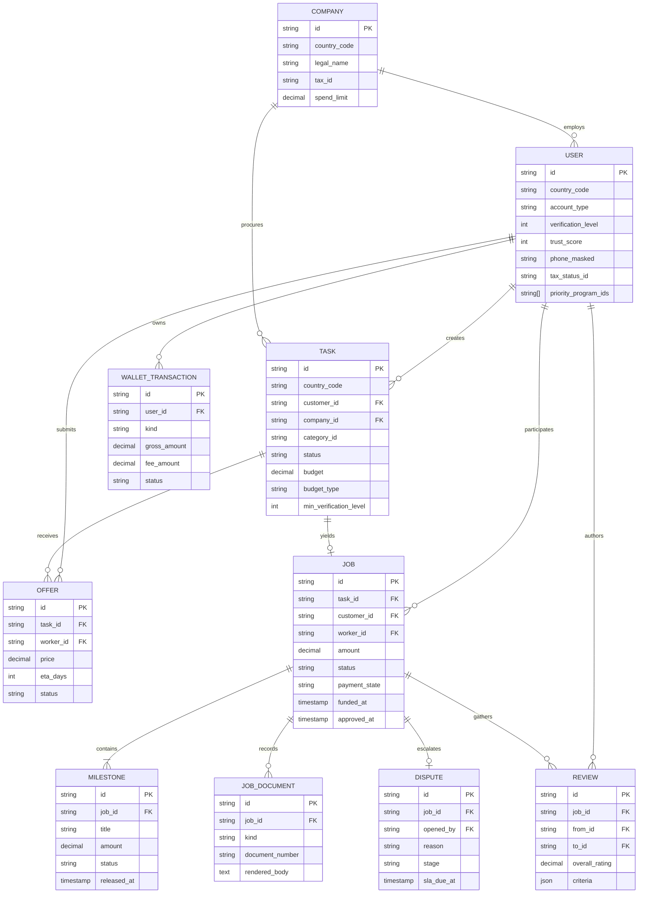

# Domain Data Model & Entity-Relationship Specifications

This document defines the core data entities, schemas, and relationships of **WorkHub**.

---

## 1. Entity-Relationship (ER) Diagram



---

## 2. Key Entities & Constraints

### 2.1 `User`
Represents an individual customer, independent worker, company representative, or administrative operator.
* `id`: Unique identifier (`usr-***`).
* `countryCode`: ISO 3166-1 alpha-2 code.
* `accountType`: `'customer' | 'worker' | 'company_member'`.
* `verificationLevel`: Strict range `0..3`.
  * `0`: Basic phone/email.
  * `1`: Photo ID + face match.
  * `2`: Digital government ID token.
  * `3`: Regulated license / verified certificate.
* `trustScore`: Calculated integer `0..100`.
* `priorityProgramIds`: Array of accredited impact tags (e.g. `['veterans']`, `['workers50']`).

### 2.2 `Task`
A posted job demand.
* `budget`: Major currency units.
* `budgetType`: `'fixed' | 'milestones'`.
* `milestonePlan`: JSON array specifying milestone shares totaling `1.0`.
* `minVerificationLevel`: Lowest worker tier permitted to bid (`0..3`).
* `preferPriority`: Soft algorithmic boost applied to bids from priority-program members.
* `status`: `'draft' | 'pending_approval' | 'open' | 'hired' | 'completed' | 'cancelled'`.

### 2.3 `Job`
An accepted, legally binding engagement between Customer and Worker.
* `status`: Stepper order:
  1. `offer_accepted`
  2. `funded`
  3. `in_progress`
  4. `delivered`
  5. `approved`
  6. `paid_out`
* `paymentState`: `'unfunded' | 'funded' | 'partially_released' | 'released' | 'refunded' | 'disputed'`.
* `amount`: Agreed gross contract amount.

### 2.4 `Milestone`
Sub-units of a job deliverable.
* `status`: `'pending' | 'in_progress' | 'delivered' | 'released' | 'refunded'`.
* Sum of milestone amounts must strictly equal `job.amount`.

### 2.5 `Dispute`
Escalation record halts automatic release and engages mediation.
* `reason`: `'quality' | 'not_completed' | 'late' | 'damage' | 'scope' | 'other'`.
* `stage`: `'opened' | 'evidence' | 'mediation' | 'decision'`.
* `slaDueAt`: Timestamp enforcement (e.g., 48 hours for evidence submission).

---

## 3. Recommended PostgreSQL Indexes

```sql
-- Fast task filtering & distance lookup
CREATE INDEX idx_tasks_country_status ON tasks(country_code, status);
CREATE INDEX idx_tasks_category ON tasks(country_code, category_id) WHERE status = 'open';

-- Fast user lookups & score tracking
CREATE INDEX idx_users_country_type ON users(country_code, account_type);
CREATE INDEX idx_users_trust_score ON users(trust_score DESC);

-- Job & Escrow lifecycle monitoring
CREATE INDEX idx_jobs_status ON jobs(status, payment_state);
CREATE INDEX idx_jobs_customer ON jobs(customer_id);
CREATE INDEX idx_jobs_worker ON jobs(worker_id);

-- Dispute SLA alerts
CREATE INDEX idx_disputes_sla ON disputes(stage, sla_due_at) WHERE stage != 'decision';
```
